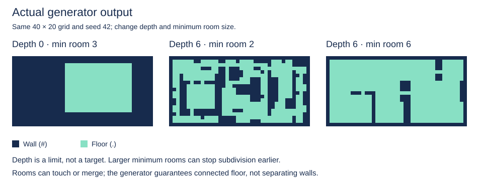
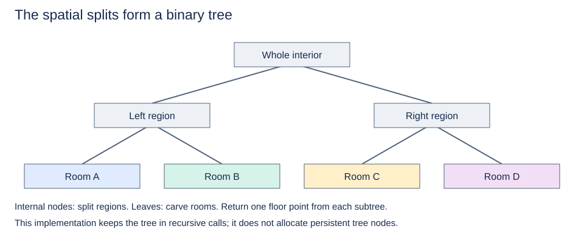
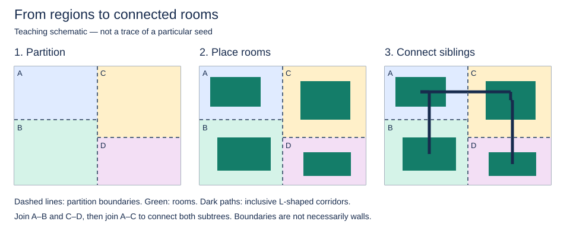
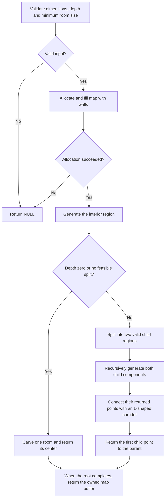

# BSP dungeon map generator


[](https://github.com/kleberandrade/bsp-tree-map-generator/actions/workflows/ci.yml)

A dependency-free C dungeon generator using binary space partitioning (BSP).
Recursively divide a rectangle, carve a room in each leaf, then join sibling
components with inclusive L-shaped corridors. Every floor cell is reachable
from every other floor cell through four-direction movement.



*Actual CLI output for seed 42. Dark cells are walls; green cells are walkable floor.*

## What is a BSP tree?

**Binary Space Partitioning** recursively divides a region into two subregions.
An internal node represents a split; its two children represent the resulting
regions. A leaf is a region that is no longer subdivided. In 2D a splitting
boundary is a line; in 3D it is a plane. General BSP boundaries need not follow
the coordinate axes. This project uses only horizontal and vertical boundaries,
so every region remains a rectangle on an integer tile grid.

“Binary” describes the two children, not binary search over sorted keys.
A BSP tree organizes **space**, whereas a binary search tree organizes values.
It also differs from a quadtree, which divides a 2D region into four children.



*The four leaves match regions A–D in the generation walkthrough below. The tree
is conceptual: this implementation stores its active path in recursive calls.*

## When did BSP trees appear, and what are they used for?

BSP grew out of computer-graphics research on visibility. Early work by
Schumacker and colleagues in **1969** explored scene partitioning and visibility
ordering. A landmark **1980** SIGGRAPH paper by **Henry Fuchs, Zvi Kedem and
Bruce Naylor**, *On Visible Surface Generation by A Priori Tree Structures*,
described preprocessing polygonal environments into BSP trees to obtain a
view-dependent polygon order. These are historical milestones, rather than a
claim that dungeon generation itself was invented in either year.
See the [original paper and abstract](https://tarheels.live/graphics/1980/06/01/fuchs-1980-visible/)
and the [history and references in the BSP FAQ](https://people.eecs.berkeley.edu/~jrs/274/bsptreefaq.html).

BSP applications include visibility ordering, ray traversal, collision queries,
solid-model operations and spatial reasoning. A partition can rule out entire
regions during a query. Which benefits apply depends on what is stored in the
tree and how its boundaries are chosen; a BSP is not automatically an efficient
solution to every spatial problem. The
[BSP FAQ](https://people.eecs.berkeley.edu/~jrs/274/bsptreefaq.html) discusses these
applications and their trade-offs.

Here BSP is used for **procedural level layout**: repeatedly divide a floor plan,
place rooms within the final regions, and connect them. The output is a tile map,
not a renderer, collision engine, pathfinder or stored tree for later queries.
It is useful for roguelike prototypes, reproducible game levels and teaching
recursive spatial subdivision.

## How this generator works



*Teaching schematic, not a trace of a particular seed. Dashed boundaries divide
regions; they do not enforce walls. First connect A–B and C–D, then connect a
representative floor cell from each subtree (A–C here).*


1. **Validate and allocate.** Reserve a row-major map filled with walls. Keep a
   one-cell border outside the generation region.
2. **Choose a split direction.** Pick horizontal or vertical using local random
   state. If one axis is too small for two minimum-sized regions, use the other.
3. **Stop or split.** Stop at depth zero or when neither axis can be divided.
   Otherwise choose a split coordinate that leaves both children large enough.
   The children are disjoint and cover the parent exactly.
4. **Carve a leaf room.** Choose width and height between the minimum room size
   and the leaf dimensions. Choose a position that keeps the room inside that
   leaf, then return its center as a representative floor cell.
5. **Join sibling components.** Generate both children, then connect their
   representative cells horizontally followed by vertically, including both
   endpoints. Return the first child's representative to the parent.
6. **Return ownership.** The caller receives the flat map and eventually frees it.

### Generation control flow



Each recursive child follows the same stop/split decision. The buffer is returned
to the caller only after the root region finishes; child calls return floor points.

### Why every room is reachable

A rectangular room is connected. If both child regions already contain connected
floor components, a corridor between a floor cell in each joins those components.
Applying that argument recursively reaches the root and therefore all rooms.
Corridor coordinates stay between their endpoints, inside their common parent,
so the protected outer wall is preserved. Flood-fill tests check the observable
result rather than relying only on this argument.

The binary tree is **implicit in the recursive calls**. A retained node structure
would consume memory without helping the current tile-output API. Regions and
representative points live on the stack; the only heap allocation in generation
is the output map. `src/bsp.c` contains these rules, `src/random.c` owns the PRNG
transition, and `cli/main.c` handles input and output.

### Depth, room size and cost

Depth zero creates one room. Maximum depth `d` permits up to `2^d` leaves, but
minimum room dimensions usually stop splitting much earlier. Increasing depth
does not guarantee more visibly separate rooms: adjacent rooms and corridors
may merge. Increasing the minimum room size restricts subdivision. Splits are
random rather than balanced, so this is not a uniform room-layout sampler.

For map area `A`, `L` leaf rooms and actual recursion depth `D`, initialization
and room carving take O(A), subdivision takes O(L), and corridor carving costs
at most O(L × (width + height)). Memory is O(A + D), with D at most 32 split
levels. The LCG uses explicit unsigned 32-bit arithmetic for reproducibility;
modulo range selection has a small bias and is not intended for statistical or
security-sensitive use.

## Requirements and quick start

Use a C11 compiler (Clang or GCC) and Make. No downloaded libraries are needed.
On Windows, use a compiler and Make through WSL or MSYS2; native MSVC is not tested.

```sh
make
./build/bsp-map
./build/bsp-map 40 20 5 3 42 > dungeon.txt
make test
make sanitize
```

Arguments are `width height depth min-room seed`, supplied together or omitted.
Defaults are `64 32 5 3 1`. Dimensions include a one-cell wall border; allowed
sizes are 3–4096 per axis. Depth is 0–32 and is an upper bound: subdivision
stops early when two minimum-sized rooms cannot fit. Minimum room size is
1 through the smaller interior dimension. Seeds are unsigned 32-bit decimal
integers, including zero. Identical parameters produce identical output across
platforms using the explicitly defined 32-bit generator. This PRNG is for games,
not cryptography. Different seeds need not produce distinct maps.

Output uses `#` for walls and `.` for floors, one row per line, on stdout.
Redirect stdout to save a map. Errors go to stderr; exits are 0 for success,
2 for malformed arguments, and 1 for invalid geometry, allocation or output failure.
There are no interactive controls.

## Library API

Include `include/bsp.h` and compile/link `src/bsp.c` and `src/random.c`:

```c
#include "bsp.h"
#include <stdlib.h>
int main(void) {
    char *map = bsp_generate(40, 20, 5, 3, 42);
    if (!map) return 1;
    /* Access map[y * 40 + x]; buffer has no row terminators. */
    free(map);
    return 0;
}
```

The caller owns the returned row-major buffer. NULL indicates invalid input or
allocation failure. Generation uses local state, no global RNG and no retained
heap tree. The map takes at most 16 MiB; recursive stack depth is at most 33.
Each split covers its parent exactly and leaves both children at least as large
as the minimum room dimension. Corridors may merge rooms; wall spacing between
rooms is not guaranteed. The outer border is never carved.

## Layout and migration

- `src/bsp.c`: partitioning, rooms and corridor generation.
- `src/random.c`: reproducible random state; its header is private to the core.
- `cli/`: command-line parsing and stdout/stderr handling.
- `include/`: public library interface.
- `examples/`: standalone library consumer and reproducible ASCII sample.
- `tests/`: behavior and CLI checks.
- `docs/images/`: versioned SVG walkthrough, tree and real-output gallery.
- `tools/render_readme.py`: reproducible documentation image generator.
- `legacy/`: original headers, Code::Blocks project and original sample map.

The original Code::Blocks project remains together with its original relative
paths in `legacy/`. It is historical, unsafe for arbitrary dimensions and is not
part of the supported build. Replace its header-defined functions with the
public API above when migrating. The new generator preserves the BSP approach,
but changes the split policy, RNG and corridor endpoints: historical maps and
seeds are not output compatible. Semicolon-delimited export is replaced by
plain ASCII redirection. The original sample remains in `legacy/map.txt`.

## Validation and limitations

`make test` checks deterministic generation, seed variation, boundary walls,
floor connectivity by flood fill, narrow/minimum/maximum dimensions, early
termination at depth 32, malformed CLI input and excessive input limits.
`make sanitize` runs the same suite with AddressSanitizer and UndefinedBehaviorSanitizer
(requires compiler support). CI runs these commands on Linux and macOS.
Allocation failure is handled but not fault-injected. No coverage percentage or
mutation score is claimed. The optional crapper, dryer and mutator tools do not
support C, so their metrics do not apply. There are no third-party runtime dependencies.

MIT licensed; see [LICENSE](LICENSE) for the original copyright and full terms.

## Runnable examples

Build and run a small library consumer without any CLI parsing:

```sh
make examples
./build/library-example
```

[`examples/library.c`](examples/library.c) demonstrates generation, row-major
cell access, output-error handling and freeing the buffer. Its output matches
[`examples/dungeon.txt`](examples/dungeon.txt), checked by `make test`.
To embed the same example directly with your compiler:

```sh
cc -std=c11 -Wall -Wextra -Wpedantic -Iinclude \
  src/bsp.c src/random.c examples/library.c -o /tmp/bsp-example
/tmp/bsp-example
```

Explore the parameters through the CLI:

```sh
# One room: no recursive subdivision.
./build/bsp-map 40 20 0 3 42
# More potential rooms, keeping a small minimum room size.
./build/bsp-map 40 20 6 2 42
# Larger rooms constrain how far subdivision can proceed.
./build/bsp-map 40 20 6 6 42
# Reproduce the committed sample.
./build/bsp-map 24 12 4 2 42 > /tmp/dungeon.txt
cmp examples/dungeon.txt /tmp/dungeon.txt
```

For a game integration, copy `BSP_FLOOR` cells into walkable tiles and `BSP_WALL`
cells into solid tiles before freeing the buffer. Entity placement, doors,
room labels and minimum separating walls require additional game-specific rules;
this API intentionally returns only terrain.

## Regenerating the README images

The SVGs are local repository assets with accessible titles/descriptions and no
external image dependencies. The gallery renders real CLI output; the region and
tree diagrams are explicitly labeled teaching schematics. To update them after
changing the generator, use Python 3 (standard library only):

```sh
make
python3 tools/render_readme.py
```

Review the resulting `docs/images/*.svg` changes with the matching code changes.
The same seed can produce a different layout after an intentional algorithm change.
